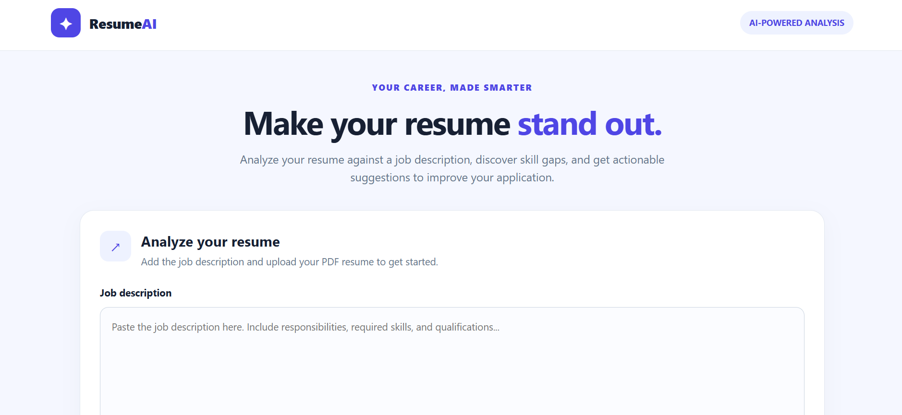

# AI Resume Analyzer 🚀

A Python-based web application that analyzes resumes against job descriptions, calculates an ATS-style compatibility score, identifies matched and missing skills, and suggests ways to improve resume alignment.

## 🌐 Live Demo

**[Try AI Resume Analyzer](https://ai-resume-analyzer-nandini.netlify.app/)**

## 📸 Project Screenshot


## ✨ Features

- 📄 Upload resumes in PDF format
- 🧠 Extract resume text and skills
- 📊 Calculate an ATS-style compatibility score
- ✅ Identify matched skills
- 🔎 Highlight missing skills
- 💡 Provide suggestions to improve job-description alignment

## 🛠️ Technology Stack

- **Backend:** Python, FastAPI
- **Frontend:** HTML, CSS, JavaScript
- **PDF Processing:** PyMuPDF
- **Deployment:** Render, Netlify
- **Version Control:** Git, GitHub

## ⚙️ How It Works

1. Upload a resume in PDF format.
2. The backend extracts the resume text and skills.
3. Enter the target job description.
4. The application compares resume skills with the job requirements.
5. View the ATS-style score, matched skills, missing skills, and suggestions.

## 📁 Project Structure

```text
AI-Resume-Analyzer/
├── backend/
│   ├── main.py
│   ├── utils/
│   │   ├── ats.py
│   │   ├── pdf_parser.py
│   │   └── resume_parser.py
│   └── uploads/
├── frontend/
│   └── index.html
├── requirements.txt
├── README.md
└── .gitignore
```

## 💻 Run Locally

### 1. Clone the repository

```bash
git clone https://github.com/nandinijuluru27/AI-Resume-Analyzer.git
cd AI-Resume-Analyzer
```

### 2. Create and activate a virtual environment

**Windows PowerShell:**

```powershell
python -m venv venv
.\venv\Scripts\Activate.ps1
```

### 3. Install dependencies

```bash
pip install -r requirements.txt
```

### 4. Start the backend

```bash
uvicorn backend.main:app --reload
```

Open `http://127.0.0.1:8000/docs` to view the API documentation.

### 5. Open the frontend

Open `frontend/index.html` in your browser. For local testing, make sure its API URL points to your running backend.

## 🎯 Project Objective

To help job seekers understand how closely their resumes match job descriptions and identify skills they may need to highlight or develop.

## 🔮 Future Enhancements

- More advanced resume parsing
- Improved job-specific skill matching
- Personalized resume improvement recommendations
- Support for additional resume formats

## 👩‍💻 Author

**Nandini Juluru**

[GitHub Profile](https://github.com/nandinijuluru27)

## 📌 Disclaimer

The compatibility score is an estimate based on the application's matching logic. It is not an official ATS score and does not guarantee shortlisting or selection.
